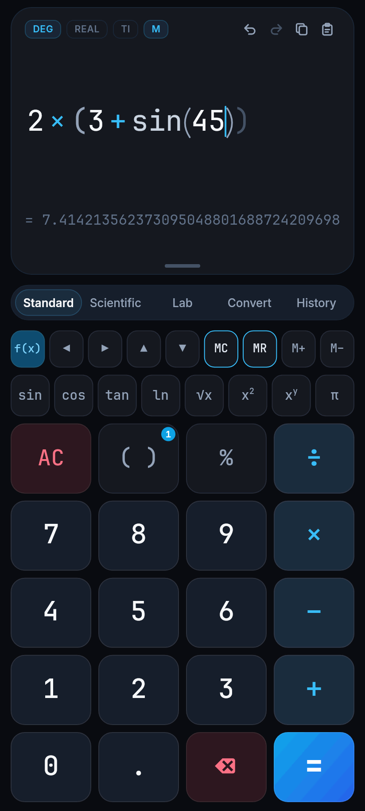
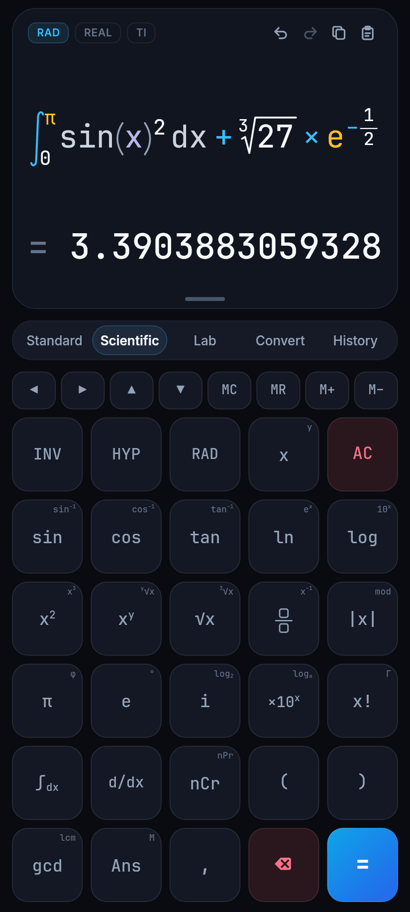
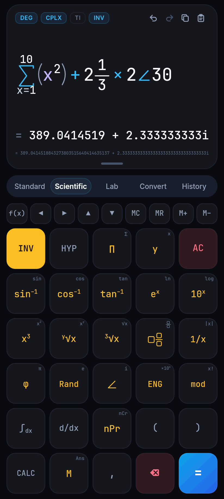
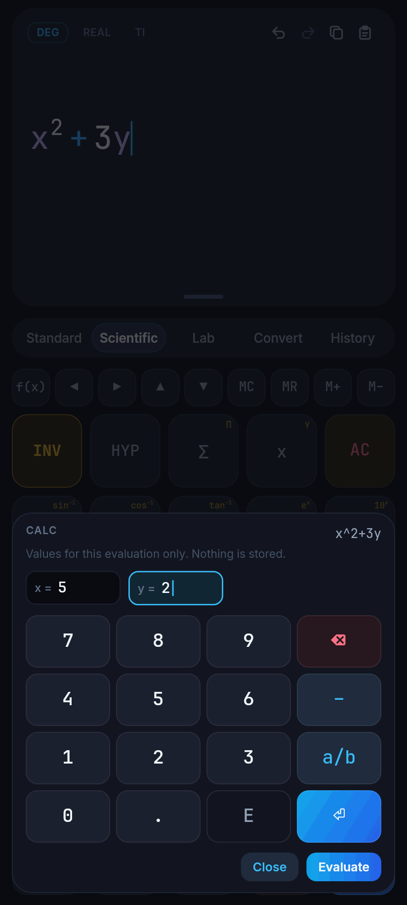
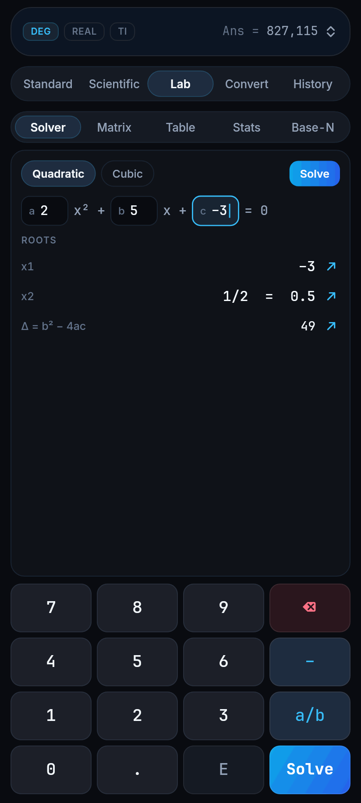
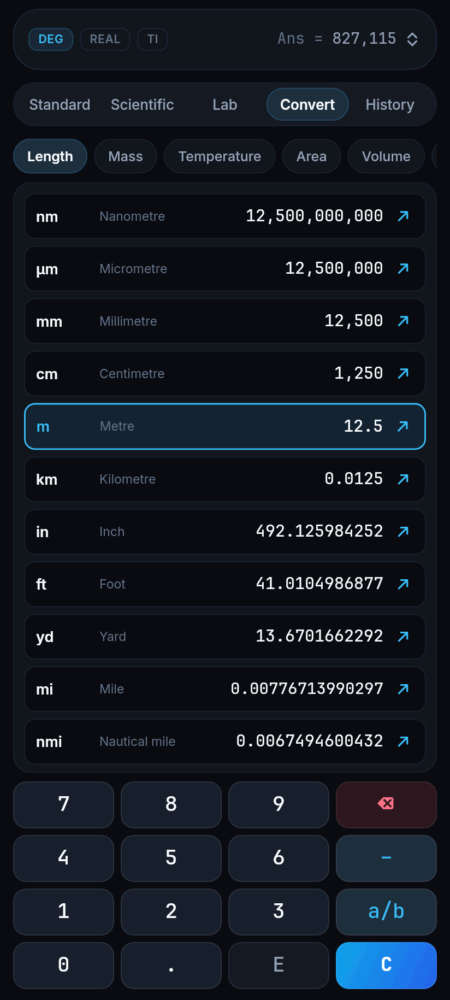
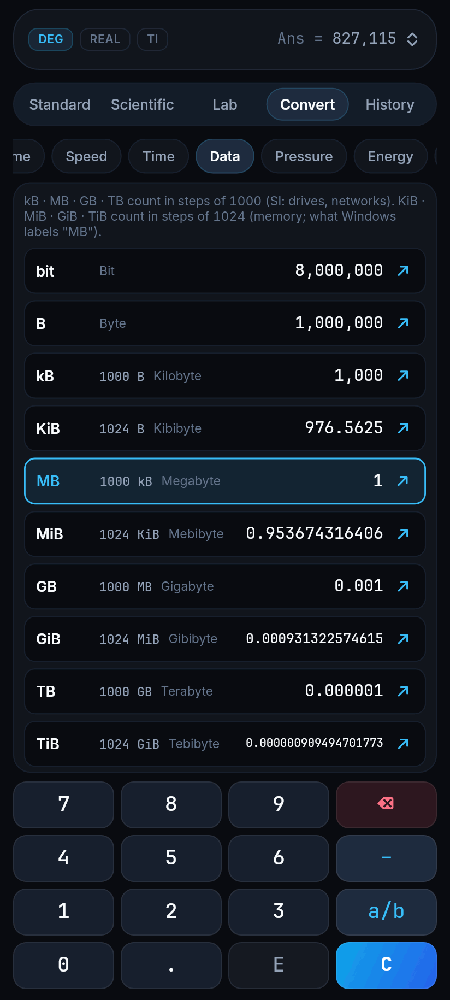
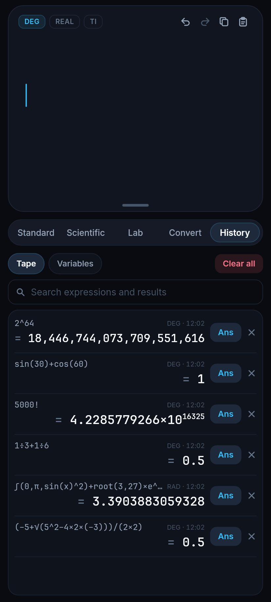
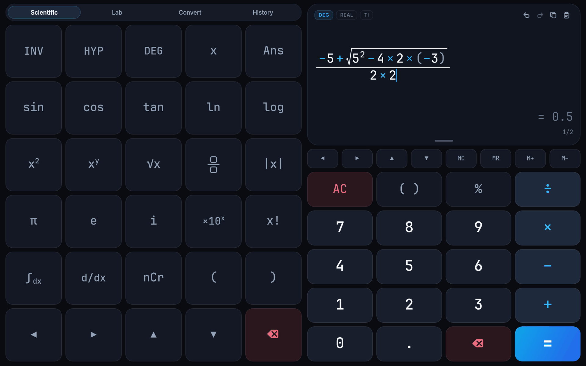

# Scientific Calculator Pro

A scientific calculator for Android, written in Flutter. Expressions are typed
and shown in two dimensions (fractions, roots, powers, integrals, sums),
numbers are exact fractions for as long as possible and 50-digit decimals
after that, and every evaluation runs off the UI thread and can be cancelled.

<p>
  
  
  
  
</p>
<p>
  
  
  
  
</p>
<p>
  
</p>

The pictures are rendered by the screenshot test of this repository
(`test/screenshots`), with the fonts the app ships.

## Contents

- [What it does](#what-it-does)
- [Download](#download)
- [Build from source](#build-from-source)
- [Signing a release](#signing-a-release)
- [Tests](#tests)
- [Continuous integration](#continuous-integration)
- [Architecture](#architecture)
- [How the numbers are computed](#how-the-numbers-are-computed)
- [Design decisions and deviations from the blueprint](#design-decisions-and-deviations-from-the-blueprint)
- [What has been verified, and what has not](#what-has-been-verified-and-what-has-not)

## What it does

**Display.** One card stays on top of every tab. It shows the expression the
way it is written on paper, a live preview of the result while typing, and the
committed result with its second form (`0.5` and `1/2`). An empty line shows a
muted `0`, and a parenthesis that has not been closed yet is drawn as a ghost
`)` where it will be closed. A line that gets too long first shrinks, then
scrolls with faded edges; the caret stays in view. Badges switch the angle
unit (DEG, RAD, GRAD), real or complex results, and how `6÷2(1+2)` is read
(TI: 9, CASIO: 1); each says in a short message what it has just switched to
(`Radians · sin(π ÷ 2) = 1`). An `ENG` badge is there while engineering
notation is on, and a tap switches it off. Undo, redo, copy and paste sit next
to them; pasted text such as `1,250.50 × 2³ − √16` is cleaned up and turned
into editable structure. Pulling the handle down opens the recent history.

Lab, Convert and History have their own input and read-out. On these tabs the
card folds into a bar that keeps the badges and shows the last answer, in
engineering notation while `ENG` is on, and the tab gets the room. While a
result of `CALC` is on display the bar shows that instead of `Ans`, behind
the values it was worked out with (`x = 5 → 28`), or the message of values
that failed; values that do not fit beside their result stand above it. A tap
on the bar opens the display where it is; the chevron folds it again, and so
does the next tab change.

**Five tabs.**

| Tab | Contents |
| --- | --- |
| Standard | Digits, `+ − × ÷`, `%`, a parenthesis key that opens or closes as needed and counts the groups that are still open, cursor keys for moving inside the 2D expression, `MC MR M+ M−` (`MC` and `MR` are outlined while the memory holds a value). `f(x)` opens a row with `sin cos tan ln √x x² xʸ π`, so that a single function does not need a tab change. |
| Scientific | The cursor and memory keys, then six rows of five (below). `INV` is an amber shift key: the corner of a key names, in the same amber, what `INV` turns it into, and the keys it has changed are amber while it is on. `INV` and `HYP` release after one key. `,` moves on to the next argument of a function and to the next slot of `∫`, `Σ` and `Π`. `f(x)` opens a row with what the grid has no key for: `log₂`, `logₐ`, `Γ`, `gcd`, `lcm`, `°`, `%`, `arg`. |
| Lab | **Solver:** quadratic and cubic equations; rational roots stay exact fractions, complex roots are shown. **Matrix:** two matrices up to 4×4; sum, difference, product, determinant, inverse, transpose, rank, trace. **Table:** values of the current expression over a range. **Stats:** one-variable summary (mean, sums, both standard deviations, quartiles) and two-variable linear regression. **Base-N:** HEX, DEC, OCT, BIN at 8, 16, 32 or 64 bits, signed or unsigned, with `AND OR XOR NOT << >>`; a tap on a base makes it the one being typed, and digits it does not have are switched off. Roots, scalar matrix results, statistics and the decimal Base-N value have a `↗` that puts them into the main expression. |
| Convert | Twelve categories (length, mass, temperature, area, volume, speed, time, data, pressure, energy, power, angle), all units of a category at once (an empty field counts as 0, and `0 °C` is `32 °F`), a `↗` on every line that puts its value into the main expression, and 24 physical constants (CODATA 2022); a tap on a constant inserts it into the expression. Data units come in both families, and every line says how its unit is built: `MB` is `1000 kB`, `MiB` is `1024 KiB` (see [Data units](#data-units)). |
| History | Searchable tape of past calculations stored in SQLite: a tap brings an expression back for editing, `Ans` inserts its result, and both return to the keypad; a long press opens the whole expression and result with copy buttons. Variable slots (`Ans`, `M`, `A`–`F`, `x`, `y`) can be inserted, filled from the last answer or cleared. |

The scientific grid, with the second function of a key in parentheses:

| | | | | |
| --- | --- | --- | --- | --- |
| `INV` | `HYP` | `Σ` (`Π`) | `x` (`y`) | `AC` |
| `sin` (`sin⁻¹`) | `cos` (`cos⁻¹`) | `tan` (`tan⁻¹`) | `ln` (`eˣ`) | `log` (`10ˣ`) |
| `x²` (`x³`) | `xʸ` (`ʸ√x`) | `√x` (`∛x`) | fraction (mixed fraction `a b/c`) | `\|x\|` (`1/x`) |
| `π` (`φ`) | `e` (`Rand`) | `i` (`∠`) | `×10ˣ` (`ENG`) | `x!` (`mod`) |
| `∫dx` | `d/dx` | `nCr` (`nPr`) | `(` | `)` |
| `CALC` | `Ans` (`M`) | `,` | `⌫` | `=` |

With `HYP` the first three keys of the second row are `sinh`, `cosh`, `tanh`
and their inverses.

- **`Σ` and `Π`** are templates like the integral: a first and a last whole
  number below and above the sign and the term behind it, with `x` running
  from one to the other. `Σ` of `x²` from 1 to 10 is `385`.
- **Mixed fraction.** `2 1/3` is typed into three slots and is `7/3`.
- **`∠`** writes a complex number by length and angle, the angle in the
  current unit: `2∠30` in DEG is `1.732050808 + 1i`. It switches complex
  results on, as `i` does.
- **`Rand`** is a random number from 0 up to, not including, 1 with ten
  decimals; `=` draws a new one every time.
- **`ENG`** switches engineering notation on and off: exponents in steps of
  three, `827115` as `827.115×10³`, with the plain number as the second form.
  It is remembered like the other modes.
- **`CALC`** evaluates a formula for values that are typed in for its
  variables. It lists every variable of the expression (`x`, `y`, letters;
  `x` when there is none), each field starting with what the variable has
  stored. **Evaluate** shows the result in the result row together with the
  values it belongs to (`x = 5, y = 2`). The formula stays in the editor with
  its caret, so `CALC` can be pressed again: the fields then hold the values
  of the result on display, and typing replaces the one being changed. The
  values are for that evaluation only: no variable is stored, `Ans` and the
  history are not touched, and values that give an error leave the formula
  open for the next ones. `=` on a variable that has no value says so and
  points to `CALC`.

In portrait one tab is visible at a time; from 600 dp of width the standard
keypad and the display stay on screen next to the other tabs (and the display
never folds). There the scientific grid leaves the cursor and memory keys to
the standard keypad, whose `f(x)` opens the row of further functions. A swipe
on the display card or the tab bar changes the tab, a swipe on the keys never
does.

**Also.** Hardware keyboards work (digits, `+ - * / ^ ( ) ! % .`, `=` or Enter,
Backspace, Esc, arrows, `x`, `y`, `e`, `p` for π; in the `CALC` prompt digits,
`. - / e`, Enter for the next field, Tab and Esc). The expression in progress,
the modes, the variables and the history survive a restart. Haptic feedback
distinguishes digits, operators, clearing and errors. Displays that support
90 or 120 Hz are asked to use it. Expression, result and errors are exposed
to screen readers as text. The app works offline: the release build does not
hold the network permission, and its fonts are bundled.

## Download

The APKs of version 3.2.0 are in [`releases/`](releases/). They are one patch
behind the sources, which are 3.2.1: what [changed in 3.2.1](#version-321) is
not in them yet, and APKs that have it are attached to the CI runs (see below
the table). The links download the file:

| File | Size | Use it for |
| --- | --- | --- |
| [`scientific-calculator-pro-3.2.0-arm64-v8a.apk`](https://github.com/Nemat-commits/scientific-calculator-pro/raw/main/releases/scientific-calculator-pro-3.2.0-arm64-v8a.apk) | 19 MB | Phones and tablets running 64-bit ARM Android (most current devices). Take this one first. |
| [`scientific-calculator-pro-3.2.0-armeabi-v7a.apk`](https://github.com/Nemat-commits/scientific-calculator-pro/raw/main/releases/scientific-calculator-pro-3.2.0-armeabi-v7a.apk) | 17 MB | 32-bit ARM Android: older devices and many entry-level ones. Take it when Android refuses the first one as not compatible. |

[`releases/README.md`](releases/README.md) has the checksums, the commit the
files were built from, and how to install them.

Every run of the
[CI workflow](https://github.com/Nemat-commits/scientific-calculator-pro/actions/workflows/ci.yml)
attaches the APKs of its commit as well, under **Artifacts** at the bottom of
the run: the two above, `app-x86_64-release.apk` (21 MB, emulators and x86
Chromebooks) and `app-release.apk` (55 MB, all three in one file). Each is an
artifact of its own and is stored as it is, so the download is the `.apk`
file, not a zip. A GitHub login is needed for artifacts, and they are kept
for 90 days.

Android 7.0 (API 24) or newer is required. Unless a keystore has been set up
(see [Signing a release](#signing-a-release)), CI signs the APKs of a run with
a debug key that exists only for that run; the files in `releases/` are such
builds. They install and run normally, but Android will not accept a later
build as an update of an earlier one: uninstall first, which also removes the
stored history.

## Build from source

Requirements: Flutter 3.50 (Dart 3.14), a JDK that the Android Gradle Plugin
accepts (CI uses 21) and Android SDK platform 36. The exact versions CI uses
are listed under [Continuous integration](#continuous-integration); nothing
older has been tried.

```sh
flutter pub get
flutter run                                    # debug build on a connected device or emulator
flutter build apk --release --split-per-abi    # build/app/outputs/flutter-apk/app-<abi>-release.apk
flutter build apk --release                    # build/app/outputs/flutter-apk/app-release.apk (universal)
```

The Drift database code (`lib/data/local_db/app_database.g.dart`) is committed.
After changing a table, regenerate it and commit the result; CI fails when the
file is out of date:

```sh
dart run build_runner build
```

Only the Android platform folder exists. The Dart code picks its platform
services through conditional imports (no SQLite and no worker isolates where
`dart:io` is missing), but no other platform has been built or tested.

## Signing a release

Without `android/key.properties` a release build is signed with the debug key,
so `flutter build apk` works on a fresh checkout. For anything that should be
installable as an update later, create a keystore once and keep it safe:

```sh
keytool -genkeypair -v -keystore upload-keystore.jks -alias upload \
        -keyalg RSA -keysize 2048 -validity 10000
```

**Local builds.** Put the keystore at `android/app/upload-keystore.jks` and
create `android/key.properties` (both are ignored by git):

```properties
storeFile=upload-keystore.jks
storePassword=<keystore password>
keyAlias=upload
keyPassword=<key password>
```

`storeFile` is resolved relative to `android/app/`.

**CI builds.** Add four repository secrets (Settings → Secrets and variables →
Actions). The build job restores the keystore from them
(`.github/scripts/release_keystore.sh`); without them it falls back to the
debug key and says so in the run.

| Secret | Value |
| --- | --- |
| `ANDROID_KEYSTORE_BASE64` | Output of `base64 -w0 upload-keystore.jks` |
| `ANDROID_KEYSTORE_PASSWORD` | Keystore password |
| `ANDROID_KEY_ALIAS` | `upload` |
| `ANDROID_KEY_PASSWORD` | Key password (may be left out when it equals the keystore password) |

The build job verifies every APK with `apksigner` and lists file, size,
SHA-256 and signer in the summary of the run.

## Tests

```sh
dart test test/domain/engine_verification_test.dart --plain-name "MathEngine"   # gate 1: TC-01 … TC-20
dart test test/domain/engine_verification_test.dart                              # gate 2: all 24 cases, under 50 ms together
dart test test/domain                                                            # the whole engine and editor suite; needs no Flutter
flutter test                                                                     # gate 3: the above plus state, isolates and widgets
CALC_SCREENSHOTS=1 flutter test test/screenshots                                 # renders 39 PNGs into build/screenshots/
```

| Suite | What it covers |
| --- | --- |
| `test/domain/engine_verification_test.dart` | The 24 verification cases of [the blueprint](#design-decisions-and-deviations-from-the-blueprint) (TC-01 … TC-24), their time budget and the precision constants. |
| `test/domain/editor_and_engines_test.dart` | Editor tree and cursor, paste clean-up, formatter, calculus, solver, matrices, statistics, Base-N, unit conversion. |
| `test/domain/sums_polar_notation_test.dart` | `Σ` and `Π`, mixed fractions, the polar form, `Rand` with a scripted source of random numbers, engineering notation, and the variables an expression depends on. |
| `test/domain/reference_values_test.dart` | The numbers of Convert and Lab against values the app did not produce (see [Checked against references](#checked-against-references)). |
| `test/presentation/calculator_notifier_test.dart` | Live preview, what the next key does after `=`, errors, undo, memory, variables, persistence of modes and draft, `CALC` (nothing stored, formula and caret kept, errors that do not lock, mode changes, undo and redo) and `ENG` (there and back, and that the short form of a huge factorial stays as it is). |
| `test/presentation/evaluator_isolate_pool_test.dart` | Evaluation on a worker isolate, cancellation by newer input, the 250 ms preview budget, the watchdog that replaces a stuck worker. |
| `test/presentation/calculator_shell_test.dart`, `display_card_test.dart` | Keys, hardware keyboard, gestures, every tab and Lab mode at four screen sizes without overflow, shrinking and scrolling of long lines, screen-reader labels. |
| `test/presentation/ux_improvements_test.dart` | The changes of 3.1: folding and reopening of the display, the notation of the answer in its bar, the messages of the modes and of the angle unit (each checked against what the calculator then computes), placeholder and ghost parentheses, the quick function row, the parenthesis counter, the corner legends of the scientific grid, sending values from Lab, Convert and History to the expression, Base-N on a small phone; the data units with their steps, and that no unit name is cut short on a phone. |
| `test/presentation/scientific_keys_test.dart` | The changes of 3.2: every key of the scientific grid in its place with and without `INV`, the colour of `INV`, the `f(x)` rows, `Σ`, `Π`, mixed fraction, `∠`, `Rand` and `ENG` from their keys, and the `CALC` prompt from the keys and from a hardware keyboard; what the folded display shows after `CALC`. |
| `test/screenshots/screenshots_test.dart` | Skipped unless `CALC_SCREENSHOTS=1`; then renders the screens at phone, small-phone, landscape and tablet sizes. |

`.github/scripts/emulator_smoke.sh <apk> <out-dir>` drives a release APK on a
running emulator or device through `adb`: typed input, `=`, `Ans`, `5000!`,
rotation, all tabs, the `INV` key, `CALC` with a value typed on the keyboard,
the folded display with that result on it, the angle unit badge and its hint,
`ENG` from its key and switched off again in the folded display, a `Σ` filled
in slot by slot, the folded display and its reopening, and a forced stop
followed by a restart, with a screenshot after every step. It
fails when the app is no longer running, when logcat shows a Flutter error or
a crash, or when a tap leaves the screen as it was. It does not read the
screen: whether the results are right and the history is back after the
restart is for a person to see in the screenshots.

## Continuous integration

`.github/workflows/ci.yml` runs on pushes to `main` and to `arena/**` working
branches and on pull requests, in three jobs:

1. **Analyze & test** — `flutter pub get`, generated code up to date,
   `flutter analyze`, `dart format` check, gates 1 to 3, screenshots
   (artifact `screenshots`).
2. **Android release APK** — per-ABI and universal APKs, signature
   verification (one artifact per APK, named after the file).
3. **Emulator smoke test** — installs the universal APK on an API 34 x86_64
   emulator and runs the script above (artifact `emulator-smoke`: screenshots
   and logcat).

Toolchain on CI: Flutter 3.50.0 (Dart 3.14.0), Temurin JDK 21, Android Gradle
Plugin 9.3.1, Gradle 9.5.0, Kotlin 2.4.20, compile and target SDK 36,
minimum SDK 24.

## Architecture

```
lib/
  core/           colours, typography, haptics, unit and constant tables
  domain/         pure Dart, no Flutter import: can be run and tested with `dart` alone
    models/       editor nodes, syntax tree, values, errors, evaluation context
    editor/       2D editing: keys, cursor paths, the post-"=" state machine, paste clean-up,
                  the variables an expression depends on
    compiler/     editor tree → tokens → implied multiplication → Pratt parser → syntax tree
    evaluator/    arithmetic, transcendental functions, gamma, calculus, complex numbers,
                  matrices, solver, statistics, Base-N, units, number formatting, cancellation
    math_engine.dart   facade over the whole pipeline
  data/           Drift database (history, variables), settings, draft of the current line
  presentation/
    isolate/      worker isolates, request protocol, shared generation counter
    state/        Riverpod notifier and UI state
    widgets/      display card, 2D expression painter, keys, tab bar, CALC prompt,
                  Lab building blocks
    tabs/         the five tab views
    screens/      the shell: portrait and two-pane layouts, hardware keyboard
  main.dart
```

**From key to result.** A key becomes a `CalcKey`. `MathPrintController`
applies it to the editor tree (`EditorNode`: atoms, fraction with or without
a whole part, power, root, function call, integral, sum, product, derivative;
nesting is limited to depth 4) and moves the cursor, which is a path into
that tree. For evaluation the tree is lowered
to tokens, implied multiplications are made explicit according to the TI or
CASIO setting, and a Pratt parser builds the syntax tree. `AstEvaluator` walks
it and returns a `CalcValue` — exact rational, decimal, complex, matrix or
fixed-width integer — which `NumberFormatter` turns into text. `CALC` is the
same evaluation with other variables: the values typed into its prompt are
laid over the stored ones for that one request.

**Off the UI thread.** `CalculatorNotifier` sends every evaluation to
`EvaluatorIsolatePool`. Two mechanisms keep the UI responsive:

- *Cooperative.* Each request carries a generation number. The newest number
  also lives in one word of native memory that the worker can read while it is
  busy, because a message would only be read once the work is finished. The
  loops of the engine compare it every 64 iterations, together with a time
  budget of 250 ms for previews and 1,500 ms for `=`, and unwind when they are
  out of date or out of time.
- *Preemptive.* If a request is still unanswered when the watchdog fires
  (1,500 ms, plus 300 ms for `=` so that its own budget can report first), the
  worker isolate is killed and a spare that is already warm takes over.

**Persistence.** History and variables are in SQLite through Drift. Settings
and the line being typed are in `SharedPreferences`, which is readable
synchronously, so the expression is back in the first frame after a cold
start. A database or worker isolate that fails or is slow to start does not
keep the calculator from starting: it falls back to an empty variable list
and to evaluation on the main isolate.

**UI.** The app uses the widgets layer only (`material.dart` is deprecated in
Flutter 3.50). The expression is laid out and painted by
`math_print_canvas.dart`, with measured glyphs cached per text scale.
JetBrains Mono and Inter (SIL Open Font License 1.1, texts in
`assets/google_fonts/`) are bundled as subsets and runtime font fetching is
switched off.

## How the numbers are computed

- **Exact first.** Number literals and the results of `+ − × ÷` and integer
  powers are fractions of big integers: `0.1 + 0.2` is `0.3` and `1/3 + 1/6`
  is `1/2`. A fraction whose numerator or denominator outgrows 2,048 bits
  becomes a decimal.
- **Decimals** carry 50 significant digits; 34 are displayed. A sum or
  difference of inexact numbers that comes out more than 42 orders of
  magnitude below its operands is the rounding of a zero and is shown as `0`
  (`log(1000) − 3`); `(1 + 10⁻²⁵) − 1` is still `1e-25`.
- **Elementary functions** use argument reduction and series at the working
  precision; angles as large as 10²⁰ rad are reduced with enough digits of π.
- **Factorial.** Integers up to 2,500 are multiplied out exactly. Above that
  the logarithmic Stirling series gives mantissa and exponent
  (`5000! = 4.2285779266 × 10^16325`). Non-integers use Spouge's
  approximation of the gamma function and are kept to 15 digits.
- **Derivative.** Central differences with Richardson extrapolation, 14
  digits. A kink or jump at the point is reported as an error instead of a
  number.
- **Integral.** Composite 5-point Gauss–Legendre on repeatedly halved panels;
  the endpoints are never sampled. When an endpoint is singular or the rule
  stalls, a substitution that flattens the endpoints is applied, up to six
  times (`∫₀¹ dx/√x = 2`). A result is accepted only if a second mesh with an
  odd number of panels agrees. 14 digits; fewer when the integral converges
  slowly.
- **No invented digits.** An integral is known to about 14 digits, so
  `∫₀^π sin²x dx + 3e^(−1/2)` must not show 34. How many digits of the final
  value can be trusted depends on what was done with the numerical result:
  adding 10¹⁵ keeps all of them, subtracting a nearly equal number loses
  nearly all. The evaluator therefore repeats the arithmetic around every
  integral, derivative and non-integer factorial with that result moved by
  its error bound, and keeps the digits both runs share. A value smaller than
  its own uncertainty is shown as `0`. `Ans` receives the same rounded value.
- **Sums and products.** `Σ` and `Π` work the term out once for every whole
  number of the range and stay exact where the terms are: `Σ 1/x` from 1 to
  10 is `7381/2520`. A range that runs backwards is empty, which makes the
  sum 0 and the product 1. Bounds that are not whole numbers are an error,
  and so are more than ten million terms; a sum that needs longer than the
  time budget is stopped like any other calculation. The `x` of the term is
  the running one; an `x` outside the sign is the stored variable.
- **Mixed fractions.** `a b/c` is `a + b/c`. A minus sign in front of it or
  in its whole part is the sign of all of it: `−2 1/3` is `−7/3`. An empty
  whole part is an error, not a zero.
- **Complex numbers** are pairs of decimals shown as `a + bi`. `r∠θ` is
  `r·(cos θ + i·sin θ)` with `θ` in the current angle unit; it binds tighter
  than `×` and `÷`, so `2×3∠45` is `2×(3∠45)` and an angle such as `π/2`
  needs parentheses. A complex result leads with both parts rounded to ten
  digits, because two numbers of 34 digits do not fit a line; all digits are
  in the line below it, and a tap swaps the two.
- **`Rand`** has ten decimals. Every `Rand` of an expression is a number of
  its own (`Rand − Rand` is not 0), there is no live preview of it, and when
  the evaluator repeats a calculation to see which digits can be trusted, it
  uses the numbers of the first run again.
- **Engineering notation** is a way of writing a result: the value, `Ans` and
  the history are the same with it and without. Numbers from 1 up to 1000
  are written plainly, and complex numbers and the short form of a giant
  factorial keep theirs.
- Matrices are grids of decimals up to 4×4; Base-N values are integers
  wrapped to the chosen word size.
- **Limits.** Exponents up to ±999,999. Function tables have at most 200 rows.

### Checked against references

The numbers of the Convert and Lab tabs are compared with values that the app
did not produce. `tool/reference/generate_reference_data.py` works them out
again from the definitions of the units (the inch of 1959, the pound, the
calorie, the standard atmosphere, …), with exact fractions, SymPy and mpmath
at 70 digits, and writes them to `test/domain/reference_data.dart`;
`test/domain/reference_values_test.dart` holds the app to them:

- all 112 unit factors, 78 conversions that standards state as round numbers
  (`1 mi = 1.609344 km`), 37 that do not come out round, and every
  conversion undone by the opposite one;
- the 24 physical constants against the CODATA 2022 values published by
  NIST, and that the value the calculator computes with is the one shown;
- the roots of 62 linear, quadratic and cubic equations;
- determinant, trace, rank, inverse, transpose, sum, difference and product
  of 19 square and 5 rectangular matrices;
- 13 data sets and 7 regressions;
- 88 Base-N operations at every word size, signed and unsigned, 32 words read
  in all four bases, and 7 function tables.

The check found two things, both corrected: the inch of mercury was
`3386.389 Pa`, rounded, instead of the `3386.388640341 Pa` that 25.4 mm of
mercury come to; and in Base-N a hexadecimal number ending in `E` in front of
`+` or `−` was read as the start of an exponent, so that `1E − 1` was a
syntax error.

### Data units

`kB`, `MB`, `GB` and `TB` count in steps of 1000, as the SI prefixes do and
as drives and network speeds are sold. `KiB`, `MiB`, `GiB` and `TiB` (IEC
80000-13) count in steps of 1024, as memory is addressed. Many programs,
Windows among them, show a number of mebibytes and label it "MB", which is
where the expectation that 1 MB is 1024 kB comes from. The converter has both
families side by side: `1 MB = 1000 kB = 976.5625 KiB`, and
`1 MiB = 1024 KiB = 1048.576 kB`. Every line of the list says how its unit is
built, and a note above the list tells the two families apart.

Where a name exists in several sizes, the line says which one it is: the
gallon, pint and spoon measures are the US ones (the imperial gallon has a
line of its own), the calorie is the thermochemical one (4.184 J), the BTU
that of the International Table, the horsepower comes as mechanical
(550 ft·lbf/s) and as metric (75 kgf·m/s), the ton as short, long and metric,
and a year is the Julian year of 365.25 days with a month as a twelfth of
it. A long name takes a second line rather than being cut.

## Design decisions and deviations from the blueprint

The app was built to a written specification, `ARCHITECTURE_BLUEPRINT.md`
("the blueprint"), which is not part of this repository. Where that document
left a choice open, or where following it literally was not possible, this is
what was done.

- **Layout of the project.** The Flutter project is at the repository root.
  The editing controller is `math_print_controller.dart`; `AngleUnit` and
  `JuxtapositionMode` are in `math_context.dart`, `InputPhase` in
  `input_phase.dart`. `package:test` is a dev dependency so that the engine
  gates run with plain `dart test`.
- **Verification cases.** TC-10 shows `0.5` as the result and `1/2` as the
  second form. TC-20 is asserted to the 14 digits given
  (`-0.64525128526578`). TC-15 is shown as `4.2285779266 × 10^16325`.
- **Stirling series.** Eight correction terms instead of two, so that the
  stored value is good to the working precision and `5000!/4999!` comes out
  clean.
- **Implied multiplication.** A number or symbol directly followed by a
  symbol (`2π`, `3x`) binds tightly in both modes. Other implied products
  (`2(…)`, `2sin(…)`) behave like `×` in TI mode and bind tighter than
  `×` and `÷` in CASIO mode. A power binds tighter than any implied product.
- **Minus sign.** JetBrains Mono draws U+2212 as narrow as a hyphen, so the
  display shows an en dash for it. Stored and copied text is unaffected.
- **Repeated `=`.** Pressing `=` again on a committed result adds no second
  history line.
- **Converter.** Starts from the base unit of a category (°C for
  temperature).
- **Android.** Application id `com.scientific.calculator.modern`.
  `flutter_displaymode` 0.6.0 pins compile SDK 33, which current AndroidX
  libraries reject; `android/build.gradle.kts` lifts plugin modules to
  SDK 36. The platform focus highlight is switched off in `MainActivity`,
  because with a hardware keyboard Android outlines the whole Flutter view.
- **Formatting.** `dart format` with a page width of 120
  (`analysis_options.yaml`).

### The UX review (versions 3.1 and 3.2)

Version 3.1 applied a written review of the layout,
`ux_and_layout_improvements_blueprint.md` (not part of this repository
either): the folding display, the mode messages, the placeholder and the
ghost parentheses, the quick function row and the parenthesis counter, the
rearranged scientific grid, and the paths from Lab, Convert and History back
into the expression. Version 3.2 adds the functions that review puts on the
grid and the engine did not have (`Σ`, `Π`, mixed fractions, `Rand`, `∠`,
`ENG`, `CALC`), gives every key the place the review gives it, makes `INV`
recognisable as a shift key, and checks the numbers of Convert and Lab
against references. Where the result differs from the review, or where it
left a choice:

- **What the grid has no room for.** With the review's keys in place, `log₂`,
  `logₐ`, `Γ`, `gcd`, `lcm` and `°` have no key of their own. They are in a
  row that `f(x)` opens above the grid, together with `%` and `arg`.
- **`INV`.** Amber, a colour no other key has: outlined while off, filled
  while on. The corner legends, which name the second functions, are amber
  too, and a key that `INV` has changed shows its new face in amber.
- **`CALC` stores nothing.** The values are laid over the stored variables
  for one evaluation, as the review asks ("temporary test values"); on a
  Casio the same key stores them. The fields start with the stored values,
  and with the values of the previous `CALC` while its result is still on
  display, so that one of several can be changed. An error leaves the line
  open instead of locking it, because the next values may be fine. A change
  of angle unit or mode works the result out again with the same values.
- **`ENG` is a mode**, not a key that rewrites one result: it stays on, is
  stored with the settings and shows as a badge.
- **`Σ` and `Π` run over `x`.** There is no slot for the name of the
  variable; pasted text may say `sum(1,10,x^2)` and `prod(1,5,x)`.
- **`Rand`** has ten decimals (the Casio `Ran#` has three).
- **The folded display opens in place.** The review allows a tap on the bar
  to jump to the Standard tab or to expand the display; it expands, so the
  tab in use stays. The bar is 56 dp high.
- **Mode messages.** Without a Material layer there is no `SnackBar`. The
  message is a widget of the app that floats over the keypad for 1.5 s and
  lets touches through. The texts are shorter than in the review, and the
  badge keeps its name `TI`.
- **Sending a value.** A `↗` at the end of the line instead of a "Use in
  Calc" chip, which the narrow lines have no room for. A negative or complex
  value is inserted in parentheses.
- **Open parentheses inside a template.** A parenthesis left open in an
  exponent, a root or a fraction is closed where that slot ends, which is
  also where its ghost is drawn: `2^(1+1` followed by `×3` outside the
  exponent is `2^(1+1) × 3`.
- **`,` on the scientific grid.** Inside a function with several arguments
  it moves the caret to the next one; elsewhere it types a separator.
- **Converter.** There was no special case for zero: the dashes came from
  an empty field, which now counts as 0.

### Version 3.2.1

Two things the folded display got wrong, and a message that was missing:

- **The answer in the bar follows `ENG`.** It was always written in the plain
  notation: with `ENG` on, the bar said `827,115` where the display says
  `827.115×10³`.
- **After `CALC` the bar shows what `CALC` gave.** `CALC` leaves `Ans` alone,
  and the bar showed `Ans` whatever was on display. After `x×x+3` with
  `x = 5` it had the badge `x = 5` next to `Ans = 42`, a number those values
  had not given. It now shows what the open display shows: the badge with
  the values, an arrow and their result (ten digits, as for `Ans`), or the
  message of values that failed. Values that do not fit beside the result
  take a line of their own above it instead of shrinking it, and so they do
  above a message of one line. A longer message runs on from the values to a
  second line and ends in `…` where the bar has no more room; a tap opens
  the display, which has all of it.
- **The angle unit says what it was switched to**, as the other modes do:
  `Degrees · sin(90) = 1`, `Radians · sin(π ÷ 2) = 1`,
  `Gradians · sin(100) = 1`.

Two things were examined and left as they are; each has a test now:

- **`ENG` there and back.** Switching `ENG` off writes the result on display
  in the plain notation again. The one result that neither direction
  rewrites is the short form of a huge factorial (`5000!` is
  `4.2285779266 × 10^16325`): those eleven digits are all that is shown of
  such a number, and written anew from its value it would come back with 34.
- **Undo and redo after `CALC`.** Both take the result of `CALC` and its
  values off the display in the step that changes the expression, so the
  badge is gone in the same frame.

## What has been verified, and what has not

On CI, with the code as it is in this commit:

- `flutter analyze` reports no issues and `dart format` no changes.
- All 24 blueprint cases pass and take 7 to 15 ms together (budget 50 ms).
- `flutter test`: 225 tests pass (112 of them engine and editor tests that
  also run under plain `dart test`); the 4 screenshot tests are skipped
  unless requested and pass when run.
- The numbers of Convert and Lab agree with the reference values (see
  [Checked against references](#checked-against-references)).
- The release APKs build, and `apksigner` accepts them.
- On an Android 14 (API 34) x86_64 emulator at 1080×2400 the release APK
  starts cold in 2 to 3.5 s, computes typed input, `Ans` and `5000!`, lays
  out in landscape, shows all five tabs with the display folded into its bar
  on Lab, Convert and History, opens the folded display on a tap, and still
  has its history after being force-stopped and restarted. On the scientific
  tab `INV` turns the keys amber, `CALC` asks for `x`, takes `5` from the
  keyboard and shows `28` for `x×x+3` with the formula still in the editor,
  and a `Σ` filled in slot by slot gives `10` for the sum of 1 to 4. While
  the result of `CALC` is on display, the bar on Lab shows `x = 5 → 28`, and
  a tap on its `DEG` badge switches to `RAD` and says
  `Radians · sin(π ÷ 2) = 1`. With `ENG` switched on by its key, `12345×67`
  reads `827.115×10³` and the bar `Ans = 827.115×10³`; a tap on the `ENG`
  badge of the bar brings `827,115` back. Logcat contains no Flutter error.
  What the screens show was read off the screenshots of a run: for 3.2.0 all
  of them, for 3.2.1 those from the result of `CALC` onwards. The run of
  3.2.1 was the one for commit `c9fbfd9` of pull request #8, which has the
  app sources of this version; the commit after it changed the CI files and
  this README only.

Not verified:

- In the folded display, values that are too long for the line of their
  result and the message of values that failed were not produced on Android.
  They are covered by widget tests and were looked at in pictures that the
  test engine rendered at 360 and 412 dp of width, at the normal and at the
  largest text size, with the layout code and the fonts of the app.
- No physical device was used. Haptics, the 90/120 Hz request, real GPUs and
  ARM hardware are exercised only by code review and by the build. The
  emulator ran the universal APK; the two ARM APKs in `releases/` come from
  the same build, and neither was installed on a device.
- Only API 34 was run. API 24 to 33 and 35+ are covered by the build
  configuration alone.
- Signing with a keystore was exercised on CI once, with a throw-away test
  key passed through `release_keystore.sh` (the APK came out signed by that
  key). The repository secrets themselves have not been set, so the APKs CI
  produces today are debug-signed.
- Screen readers: labels are checked by tests, TalkBack itself was not run.

The earlier WebView-based app was removed from the tree in favour of this
implementation. Its releases were numbered 3.1.x as well: the tag `v3.1` is
one of them and is not version 3.1.0 of this app. Its history remains in git,
and the `gh-pages` branch still serves its web demo.
